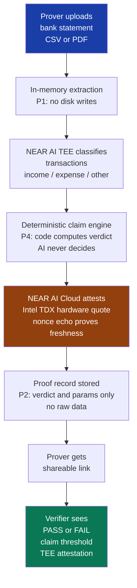
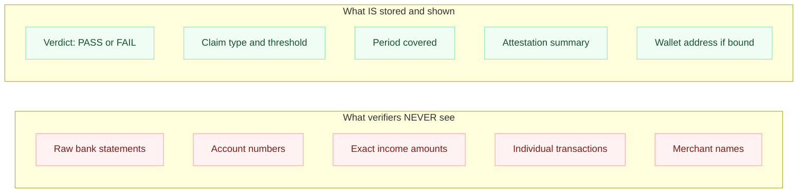
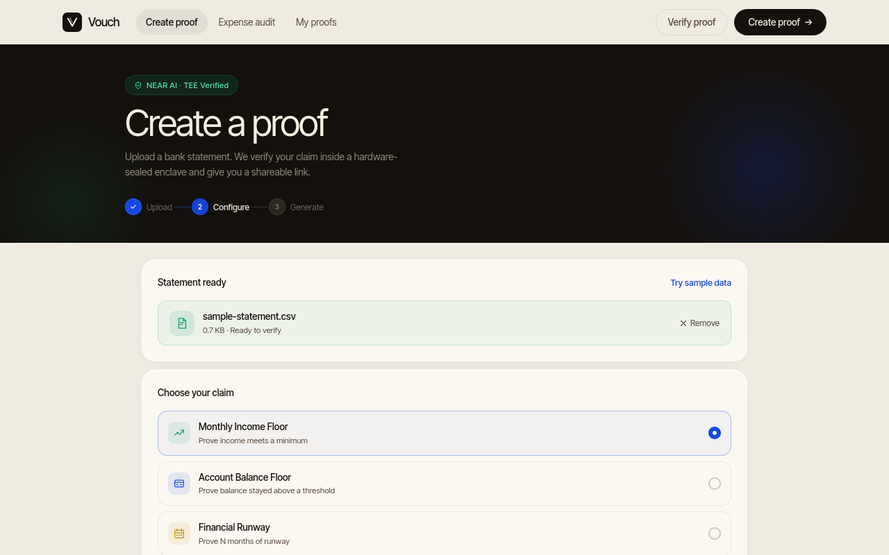
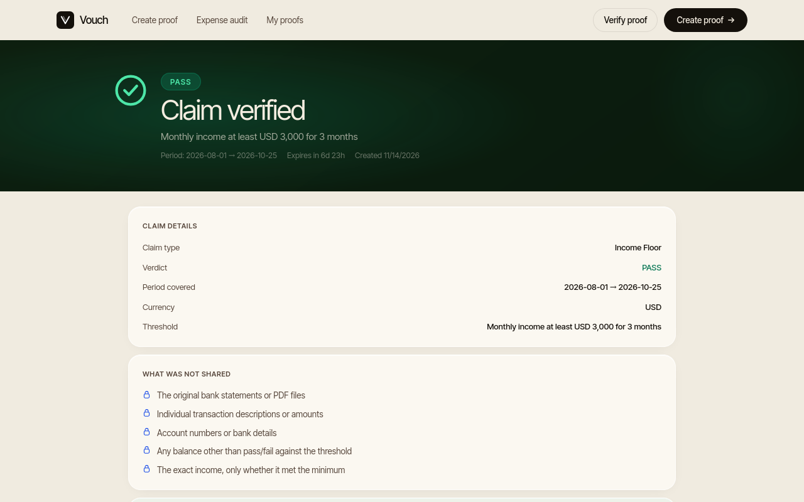
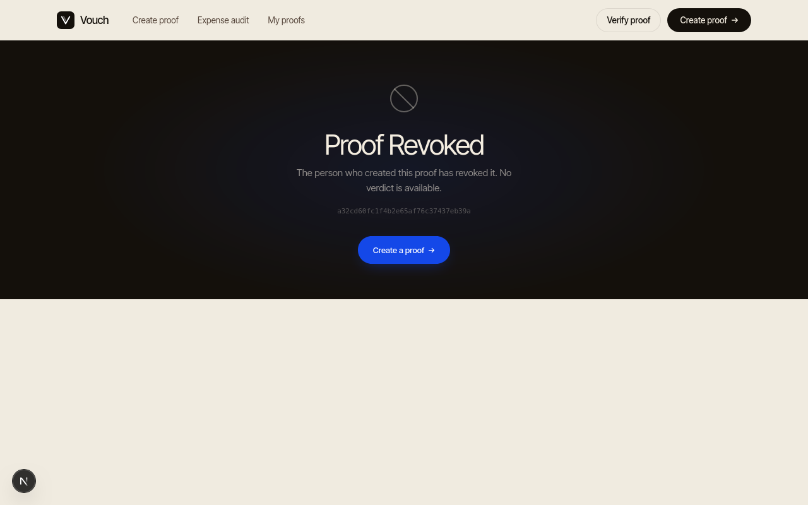

# Vouch — Share the proof, not the document

> **Privacy-first financial verification powered by NEAR AI Cloud's Trusted Execution Environment.**

[](https://vouch-ten-smoky.vercel.app)
[](https://near.org)
[](LICENSE)
[](#running-tests)

---

## The problem

Landlords, lenders, and DAOs need to verify financial facts — but asking someone to hand over a full bank statement means sharing **everything**: every transaction, every merchant, every subscription, every balance. That is a catastrophic privacy violation for a simple yes/no question.

## What Vouch does

Vouch lets a prover answer "does this person earn ≥ $X/month?" with a cryptographically attested **PASS or FAIL** — and nothing else.

The document never leaves the prover's device in readable form. The analysis runs inside a **hardware-sealed Intel TDX Trusted Execution Environment** on NEAR AI Cloud. The verifier gets a shareable link that shows the verdict, the claim threshold, and the TEE attestation. No amounts. No account numbers. No transaction descriptions.

---

## How it works



---

## Three tools in one

### 1. Prover flow — `/prove`

Upload a bank statement, pick a claim type and threshold, generate a proof link in ~15 seconds.

**Supported claim types:**

| Claim | What it proves | Use case |
|---|---|---|
| **Monthly Income Floor** | Income ≥ X every month for N consecutive months | Rental applications, loan eligibility |
| **Account Balance Floor** | Balance never dropped below X over a rolling window | Collateral verification, DAO membership |
| **Financial Runway** | Current balance ÷ avg monthly spend ≥ N months | Startup funding, visa applications |

**Optional: wallet identity binding** — sign with your Ethereum wallet to cryptographically prove you generated this proof, not someone else.

### 2. Private Expense Auditor — `/audit`

Ephemeral, zero-storage spending analysis. Upload a statement, get an instant breakdown of income vs. expenses vs. self-transfers, with anomaly detection (large transactions, same-day duplicates, high-frequency bursts). The report is fully in-memory — nothing is persisted after the response is sent.

### 3. Verifier page — `/v/:id`

A verifier receives a link, opens it, and sees:
- Verdict badge (PASS / FAIL)
- Claim type and threshold
- Period covered
- TEE attestation status and signing address
- Integrity flags (if any)
- Wallet address (if the prover bound one)

---

## Privacy model



### Five privacy invariants

| ID | Invariant |
|---|---|
| **P1** | No raw document data is ever written to disk or logged |
| **P2** | Only verdict, claim parameters, and attestation summary are stored |
| **P3** | All model calls go exclusively to NEAR AI Cloud |
| **P4** | Code performs all arithmetic and determines verdicts; the AI model classifies transaction types only |
| **P5** | Document content is untrusted — instructions embedded in documents are never followed |

---

## NEAR AI TEE attestation

Every proof is backed by a live attestation fetch from the NEAR AI Cloud gateway:

```
GET https://cloud-api.near.ai/v1/attestation/report
    ?signing_algo=ecdsa
    &nonce=<64-hex-random>
```

Vouch runs **10 structural verification checks** on every attestation response:

| # | Check | What it verifies |
|---|---|---|
| 1 | `gateway_present` | The attestation object exists in the response |
| 2 | `nonce_echo` | The gateway echoed back our nonce (prevents replay attacks) |
| 3 | `signing_address_present` | The TEE's ECDSA identity is included |
| 4 | `intel_quote_present` | Intel TDX hardware quote is non-empty |
| 5 | `event_log_present` | RTMR3 replay material is included |
| 6 | `report_data_present` | Hardware-bound signing key data is present |
| 7 | `signing_algo_match` | Algorithm is ECDSA as requested |
| 8 | `app_compose_present` | Docker composition hash (MRCONFIGID binding) is present |
| 9 | `intel_quote_tdx_structure` | Quote is a valid Intel TDX v4/v5 binary (TEE type `0x81`) |
| 10 | `report_data_64_bytes` | Report data is exactly 64 bytes of hex (key-to-hardware binding) |

> Full DCAP/TDX quote cryptographic verification (dcap-qvl) requires native C++ bindings and is on the roadmap. The current checks verify everything accessible through the HTTP API.

---

## Stack

| Layer | Technology |
|---|---|
| Framework | Next.js 15 (App Router) + TypeScript |
| AI / TEE | NEAR AI Cloud — `z-ai/glm-5.3-flash` via OpenAI-compatible API |
| Storage | Vercel KV (Redis) in production · SQLite (`better-sqlite3`) in dev |
| PDF parsing | `pdf-parse` |
| Wallet signing | `ethers` v6 — EIP-191 `personal_sign` |
| Styling | Tailwind CSS v3 |
| Testing | Vitest (unit) · Playwright (e2e) |

---

## Screenshots

| Prover — Upload | Prover — Configure claim | Prover — Result |
|---|---|---|
|  |  |  |

| Verifier — Valid proof | Verifier — Revoked | Verifier — Expired |
|---|---|---|
|  |  |  |

---

## Quick start

### Prerequisites

- Node.js 18+
- A [NEAR AI Cloud](https://app.near.ai) API key (free tier available)

### Setup

```bash
# Clone and install
git clone https://github.com/nisargpatel7042lva/vouch.git
cd vouch
npm install

# Set environment variables
cp .env.example .env
# Edit .env — set NEAR_AI_API_KEY=your_key_here
```

### Environment variables

| Variable | Required | Description |
|---|---|---|
| `NEAR_AI_API_KEY` | **Yes** | NEAR AI Cloud API key — get one at [app.near.ai](https://app.near.ai) |
| `NEAR_AI_BASE_URL` | No | Override API base URL (default: `https://cloud-api.near.ai/v1`) |
| `NEAR_AI_MODEL` | No | Override TEE model (default: `z-ai/glm-5.3-flash`) |
| `KV_REST_API_URL` | No | Vercel KV URL — if set, switches storage from SQLite to Redis |
| `KV_REST_API_TOKEN` | No | Vercel KV auth token |

### Run

```bash
npm run dev
# Open http://localhost:3000
```

Click **"Try sample data"** on the `/prove` page to test the full flow without uploading your own file.

---

## Running tests

```bash
# Unit tests — 97 tests, no API key required
npm test

# Watch mode
npm run test:watch

# Live integration tests — requires NEAR_AI_API_KEY (makes real NEAR AI calls)
npm run test:live

# End-to-end tests — requires running dev server
npm run dev &
npx playwright test
```

---

## Project structure

```
app/
├── page.tsx                  Landing page
├── prove/                    /prove — prover flow (upload → claim → generate)
├── audit/                    /audit — private expense auditor (ephemeral)
├── v/[id]/                   /v/:id — verifier page
├── my-proofs/                /my-proofs — proof history (localStorage)
├── about/                    /about — privacy model explanation
└── api/
    ├── proofs/               POST create proof · GET proof by ID
    ├── proofs/[id]/
    │   ├── bind-wallet/      POST bind Ethereum wallet via EIP-191
    │   └── revoke/           POST revoke proof using revoke token
    ├── audit/                POST ephemeral audit (zero storage)
    └── attest/live/          GET fresh attestation report

lib/
├── near/
│   ├── client.ts             NEAR AI Cloud OpenAI-compatible client
│   └── attest.ts             Attestation fetch + 10-check verifier
├── extract/
│   ├── index.ts              Entry point: buffer → classified transactions
│   ├── parse-csv.ts          CSV parser with auto-detect column names
│   ├── parse-pdf.ts          PDF line-pattern parser (fallback)
│   ├── classify.ts           NEAR AI TEE transaction classifier
│   ├── integrity.ts          Heuristic integrity flags
│   └── schema.ts             Zod schemas
├── claims/
│   └── index.ts              Deterministic claim engine
├── proofs/
│   ├── index.ts              Store router (KV ↔ SQLite)
│   ├── kv-store.ts           Vercel KV (production)
│   ├── db.ts                 SQLite (dev / test)
│   └── rate-limit.ts         Per-IP rate limiter
└── audit/
    └── index.ts              Spending breakdown + anomaly detection

tests/
├── claims/                   Claim engine unit tests
├── extract/                  Parsing + privacy invariant tests
├── near/                     Attestation verification tests (18 cases)
├── proofs/                   Proof record storage tests
├── security/                 Prompt injection + integrity tests
└── e2e/                      Playwright end-to-end tests
```

---

## API reference

### `POST /api/proofs`

Creates a proof from an uploaded bank statement.

**Request** — `multipart/form-data`

| Field | Type | Description |
|---|---|---|
| `file` | File | Bank statement — CSV or PDF, max 10 MB |
| `claimType` | string | `income_floor` \| `balance_floor` \| `runway_floor` |
| `params` | JSON string | Claim parameters (see below) |
| `expiryHours` | number | `24` \| `168` \| `720` |

**Params by claim type:**

```jsonc
// income_floor — income >= X every month for N months
{ "minMonthlyAmount": 3000, "months": 3, "currency": "USD" }

// balance_floor — balance never dropped below X in the last N days
{ "minBalance": 1000, "windowDays": 30, "currency": "USD" }

// runway_floor — balance / avg monthly spend >= N months
{ "minMonths": 6, "windowDays": 90, "currency": "USD" }
```

**Response**

```jsonc
{
  "id": "a1b2c3d4e5f6...",
  "verdict": true,
  "claimType": "income_floor",
  "currency": "USD",
  "periodStart": "2026-08-01",
  "periodEnd": "2026-10-31",
  "expiresAt": "2026-11-21T12:00:00.000Z",
  "createdAt": "2026-11-14T12:00:00.000Z",
  "attestationPassed": true,
  "revokeToken": "abc123..."  // ← shown once; store it to revoke later
}
```

### `GET /api/proofs/:id`

Returns the public proof record. No authentication required.

### `POST /api/proofs/:id/bind-wallet`

Binds an Ethereum wallet to a proof via EIP-191 signature.

```json
{ "walletAddress": "0xabc...", "walletSignature": "0xdef..." }
```

### `POST /api/proofs/:id/revoke`

Revokes a proof permanently using the revoke token shown at creation.

```json
{ "token": "abc123..." }
```

### `POST /api/audit`

Ephemeral expense audit. Returns a spending report. Nothing is stored.

**Request** — `multipart/form-data` with a `file` field (CSV or PDF).

---

## Security

See [`docs/red-team.md`](docs/red-team.md) for a full analysis covering 7 attack scenarios:

1. **Prompt injection** via transaction descriptions — blocked by `[TRANSACTION_START]...[TRANSACTION_END]` delimiters and an explicit system-prompt fence. Even a successful injection cannot change the verdict (P4: code computes, not AI).
2. **Fabricated bank statements** — flagged by integrity checks (balance discontinuity, date gaps, round-amount bias).
3. **Balance-stuffing attacks** — P4 ensures the AI only classifies labels; it cannot inflate income or balances.
4. **API parameter tampering** — all params are validated server-side; verdict is derived from the raw transactions.
5. **Rate limiting** — per-IP rate limiter on all compute routes.
6. **Revoke token security** — tokens are SHA-256 hashed before storage; shown once to the prover.
7. **XSS prevention** — no user-supplied content is ever rendered as raw HTML.

---

## Limitations (v1)

- **Single currency** — multi-currency statements are not supported
- **Document authenticity** — Vouch proves "the document says X", not "X is definitely true". For guaranteed authenticity, verifiers should request notarised statements from the prover's bank directly
- **Full DCAP verification** — cryptographic verification of Intel TDX quotes (dcap-qvl) is roadmap

---

## Why this wins the Privacy Track

Privacy is usually a policy promise: "We won't share your data." Vouch makes sharing the raw data **architecturally impossible**.

The document is processed inside hardware-sealed memory. The signing key never leaves the TEE. The only output — a PASS or FAIL with a threshold — is structurally incapable of leaking what it was computed from.

> "Not hidden by policy — structurally withheld."

---

## License

MIT © 2026 Vouch contributors
