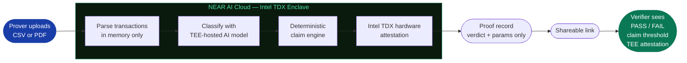
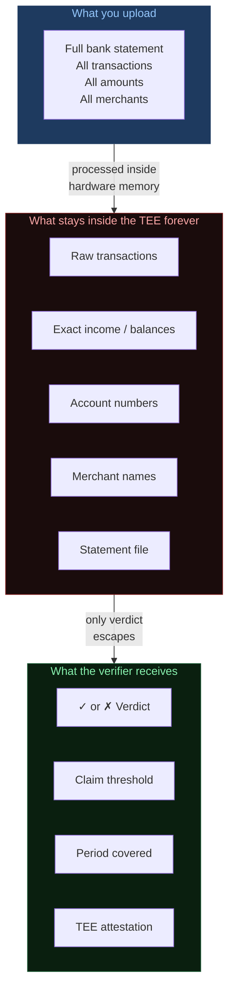
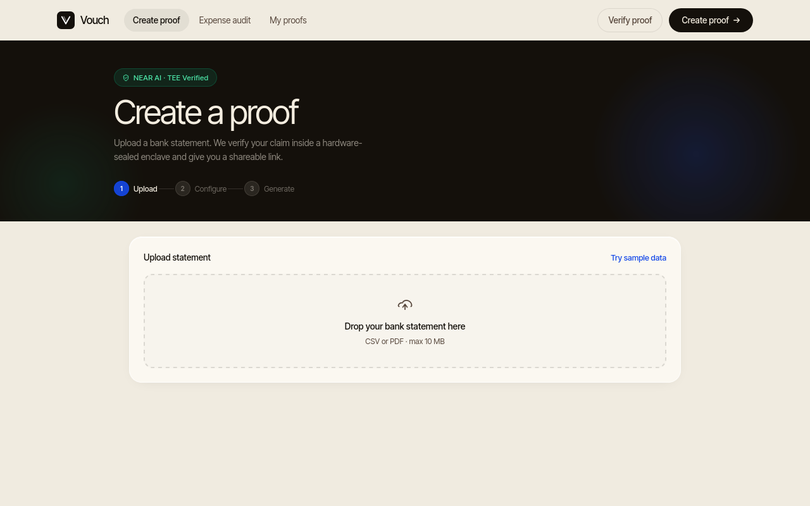
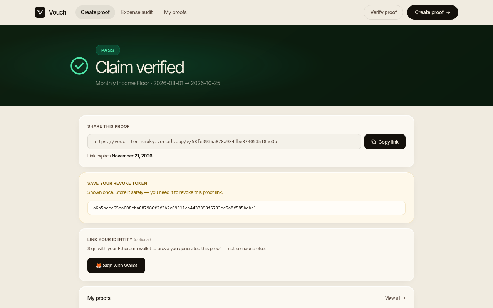

<h1 align="center">
  <br/>
  Vouch
  <br/>
</h1>

<h3 align="center">Prove financial facts without sharing documents.</h3>

<p align="center">
  <a href="https://vouch-ten-smoky.vercel.app"></a>
  <a href="https://near.ai"></a>
  <a href="https://docs.near.ai/cloud/introduction"></a>
  
  
</p>

<br/>

> Upload a bank statement. Vouch runs the analysis inside a hardware-sealed enclave — your data never leaves the chip. The verifier gets a PASS or FAIL. Nothing else.

---

## The problem

Landlords, lenders, and DAOs need to verify financial facts. But handing over a full bank statement exposes everything — every merchant, every subscription, every balance — for a question that only needs a yes or no.

Vouch answers that question with a cryptographically attested verdict and nothing more.

---

## How it works



1. **Prover uploads** a CSV or PDF bank statement.
2. **NEAR AI Cloud TEE** parses and classifies transactions entirely inside a hardware-sealed Intel TDX enclave — no plaintext ever reaches Vouch's application layer.
3. **Deterministic code** (not the AI) computes the verdict from classified labels.
4. **Intel TDX attests** the computation with an unforgeable hardware signature.
5. **Prover shares a link.** Verifier sees only: verdict, threshold, period, attestation. No amounts, no account numbers, no transactions.

---

## Features

### Prover flow — `/prove`

Upload a bank statement, configure a claim, and get a shareable link in under 60 seconds. No account required.

**Three claim types:**

| Claim | What it proves | Example threshold |
|---|---|---|
| **Monthly Income Floor** | Income ≥ X every month for N consecutive months | ≥ $3,000/mo for 3 months |
| **Account Balance Floor** | Balance never dropped below X over a rolling window | Never below $1,000 in 30 days |
| **Financial Runway** | Current balance ÷ avg monthly spend ≥ N months | ≥ 6 months runway |

**Optional:** bind an Ethereum wallet to the proof via EIP-191 `personal_sign` — proves you generated this proof, not someone else.

---

### Private Expense Auditor — `/audit`

Ephemeral, zero-storage spending analysis. Upload a statement → instant breakdown of income vs. expenses vs. self-transfers, with anomaly detection. The report is fully in-memory — nothing is persisted.

---

### Verifier page — `/v/:id`

Anyone with the link sees:
- PASS / FAIL verdict
- Claim type and exact threshold
- Period covered
- Intel TDX attestation status + TEE signing address
- Integrity flags
- Ethereum wallet address (if bound by prover)

---

## Privacy model



**Five privacy invariants — enforced in code, not policy:**

| ID | Rule |
|---|---|
| **P1** | No raw document data is ever written to disk or logged |
| **P2** | Only verdict, claim parameters, and attestation summary are persisted |
| **P3** | All model calls go exclusively to NEAR AI Cloud |
| **P4** | Code computes all arithmetic and verdicts — the AI model classifies transaction types only |
| **P5** | Document content is untrusted — instructions embedded in documents are never followed |

---

## NEAR AI TEE attestation

Every proof record includes a live attestation from the NEAR AI Cloud gateway. Vouch generates a fresh 64-byte random nonce per request, fetches the attestation, and runs **10 structural checks**:

```
GET https://cloud-api.near.ai/v1/attestation/report
    ?signing_algo=ecdsa
    &nonce=<64-hex>
```

| # | Check | What it verifies |
|---|---|---|
| 1 | `gateway_present` | Attestation object exists in the response |
| 2 | `nonce_echo` | Gateway echoed our nonce — prevents replay attacks |
| 3 | `signing_address_present` | TEE ECDSA identity is included |
| 4 | `intel_quote_present` | Intel TDX hardware quote is non-empty |
| 5 | `event_log_present` | RTMR3 replay material is present |
| 6 | `report_data_present` | Hardware-bound signing key data is present |
| 7 | `signing_algo_match` | Algorithm is ECDSA as requested |
| 8 | `app_compose_present` | Docker composition hash (MRCONFIGID) is present |
| 9 | `intel_quote_tdx_structure` | Quote is a valid Intel TDX v4/v5 binary (TEE type `0x81`) |
| 10 | `report_data_64_bytes` | Report data is exactly 64 hex bytes (key-to-hardware binding) |

Attestation verification is independently documented at [docs.near.ai/cloud/verification](https://docs.near.ai/cloud/verification).

> Full DCAP/TDX quote cryptographic verification (dcap-qvl) requires native C++ bindings and is roadmap. The current checks verify everything accessible through the HTTP API.

---

## Stack

| Layer | Technology |
|---|---|
| Framework | Next.js 15 App Router + TypeScript |
| AI / TEE | [NEAR AI Cloud](https://docs.near.ai/cloud/introduction) — `z-ai/glm-5.3-flash` via OpenAI-compatible API |
| Storage | Vercel KV (Redis) in production · SQLite (`better-sqlite3`) in dev |
| PDF parsing | `pdf-parse` |
| Wallet identity | `ethers` v6 — EIP-191 `personal_sign` |
| Styling | Tailwind CSS v3 |
| Testing | Vitest (unit) · Playwright (e2e) |

---

## Screenshots

| Prover — Upload | Prover — Configure claim | Prover — Result |
|:---:|:---:|:---:|
|  |  |  |

| Verifier — Valid proof | Verifier — Revoked | Verifier — Expired |
|:---:|:---:|:---:|
|  |  |  |

---

## Quick start

### Prerequisites

- Node.js 18+
- A NEAR AI Cloud API key — get one free at [cloud.near.ai/signin](https://cloud.near.ai/signin)

### Setup

```bash
git clone https://github.com/nisargpatel7042lva/vouch.git
cd vouch
npm install

cp .env.example .env
# Set NEAR_AI_API_KEY in .env
```

### Environment variables

| Variable | Required | Description |
|---|---|---|
| `NEAR_AI_API_KEY` | **Yes** | NEAR AI Cloud API key |
| `NEAR_AI_BASE_URL` | No | Override API base (default: `https://cloud-api.near.ai/v1`) |
| `NEAR_AI_MODEL` | No | Override model (default: `z-ai/glm-5.3-flash`) |
| `KV_REST_API_URL` | No | Vercel KV URL — switches storage from SQLite to Redis |
| `KV_REST_API_TOKEN` | No | Vercel KV auth token |

### Run

```bash
npm run dev
# Open http://localhost:3000
```

Hit **"Try sample data"** on `/prove` to run the full flow without uploading your own file.

---

## Running tests

```bash
# Unit tests — 97 tests, no API key needed
npm test

# Watch mode
npm run test:watch

# Live integration tests — requires NEAR_AI_API_KEY
npm run test:live

# End-to-end (requires running dev server)
npm run dev &
npx playwright test
```

---

## Project structure

```
app/
├── prove/              Prover flow — upload → claim → generate
├── audit/              Private expense auditor (ephemeral, nothing stored)
├── v/[id]/             Verifier page
├── my-proofs/          Proof history (localStorage only)
├── about/              Privacy model explainer
└── api/
    ├── proofs/         POST create proof  ·  GET proof by ID
    ├── proofs/[id]/
    │   ├── bind-wallet/   POST — EIP-191 wallet binding
    │   └── revoke/        POST — revoke by token
    ├── audit/          POST — ephemeral audit (zero storage)
    └── attest/live/    GET — fresh attestation (no claim)

lib/
├── near/
│   ├── client.ts       NEAR AI Cloud OpenAI-compatible client
│   └── attest.ts       Attestation fetch + 10-check verifier
├── extract/
│   ├── index.ts        Entry point: buffer → classified transactions
│   ├── parse-csv.ts    CSV parser with auto-detect column names
│   ├── parse-pdf.ts    PDF fallback line-pattern parser
│   ├── classify.ts     NEAR AI TEE transaction classifier
│   ├── integrity.ts    Heuristic integrity flags
│   └── schema.ts       Zod schemas
├── claims/
│   └── index.ts        Deterministic claim engine (income · balance · runway)
├── proofs/
│   ├── index.ts        Store router — KV in production, SQLite in dev
│   ├── kv-store.ts     Vercel KV implementation
│   ├── db.ts           SQLite implementation
│   └── rate-limit.ts   Per-IP rate limiter
└── audit/
    └── index.ts        Spending breakdown + anomaly detection engine

tests/
├── claims/             Claim engine unit tests
├── extract/            Parsing + privacy invariant tests
├── near/               Attestation verification tests (18 cases)
├── proofs/             Proof record storage tests
├── security/           Prompt injection + integrity tests
└── e2e/                Playwright end-to-end tests
```

---

## API reference

### `POST /api/proofs`

**Request** — `multipart/form-data`

| Field | Type | Description |
|---|---|---|
| `file` | File | Bank statement — CSV or PDF, max 10 MB |
| `claimType` | string | `income_floor` \| `balance_floor` \| `runway_floor` |
| `params` | JSON | Claim parameters |
| `expiryHours` | number | `24` \| `168` \| `720` |

**Params by claim type:**

```jsonc
// income_floor — income >= threshold every month for N months
{ "minMonthlyAmount": 3000, "months": 3, "currency": "USD" }

// balance_floor — balance never dropped below threshold in last N days
{ "minBalance": 1000, "windowDays": 30, "currency": "USD" }

// runway_floor — balance / avg monthly spend >= N months
{ "minMonths": 6, "windowDays": 90, "currency": "USD" }
```

**Response**

```jsonc
{
  "id": "a1b2c3d4...",
  "verdict": true,
  "claimType": "income_floor",
  "currency": "USD",
  "periodStart": "2026-08-01",
  "periodEnd": "2026-10-31",
  "expiresAt": "2026-11-21T00:00:00Z",
  "createdAt": "2026-11-14T00:00:00Z",
  "attestationPassed": true,
  "revokeToken": "..."   // shown once — save it to revoke later
}
```

### `GET /api/proofs/:id`
Returns the public proof record. No auth required.

### `POST /api/proofs/:id/bind-wallet`
Bind an Ethereum wallet via EIP-191 signature.
```json
{ "walletAddress": "0xabc...", "walletSignature": "0x..." }
```

### `POST /api/proofs/:id/revoke`
Permanently revoke a proof.
```json
{ "token": "..." }
```

### `POST /api/audit`
Ephemeral expense audit — `multipart/form-data` with a `file` field. Nothing stored.

---

## Security

Full analysis in [`docs/red-team.md`](docs/red-team.md). Seven attack scenarios covered:

| Scenario | Mitigation |
|---|---|
| **Prompt injection** via transaction descriptions | `[TRANSACTION_START]...[TRANSACTION_END]` delimiters + explicit system prompt fence. Even a successful injection cannot change the verdict (P4: code computes, AI never does). |
| **Fabricated bank statements** | Balance discontinuity, date gaps, and round-amount-bias integrity flags |
| **Balance stuffing** | AI classifies labels only; deterministic code computes verdict from labels (P4) |
| **API parameter tampering** | All params validated server-side; verdict derived from raw transactions, not client claims |
| **Rate limiting** | Per-IP rate limiter on all compute routes |
| **Revoke token theft** | Tokens are SHA-256 hashed before storage; shown once to prover |
| **XSS** | No user-supplied content is ever rendered as raw HTML |

---

## Limitations (v1)

- **Single currency** — multi-currency statements are not supported
- **Document authenticity** — Vouch proves "the document says X", not "X is true". For guaranteed authenticity, verifiers should request notarised statements from the prover's bank
- **Full DCAP verification** — cryptographic verification of Intel TDX quotes (dcap-qvl) is roadmap

---

## Built for NEAR Hackathon — Privacy Track

Privacy is usually a policy promise. Vouch makes sharing raw financial data **architecturally impossible**.

The statement is processed inside hardware-sealed memory on NEAR AI Cloud. The signing key never leaves the TEE. The only output is a binary verdict and a threshold — structurally incapable of leaking what it was computed from.

> *"Not hidden by policy — structurally withheld."*

**Resources:**
- [NEAR AI Cloud Docs](https://docs.near.ai/cloud/introduction)
- [TEE Verification Guide](https://docs.near.ai/cloud/verification)
- [Get an API Key](https://cloud.near.ai/signin)

---

## License

MIT © 2026 Vouch
